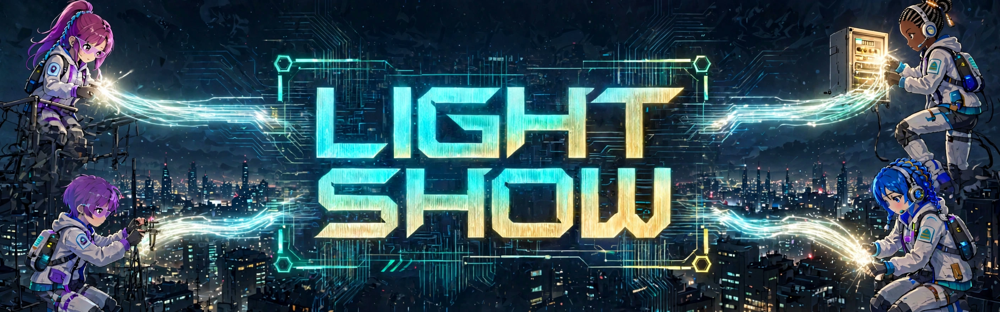
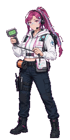
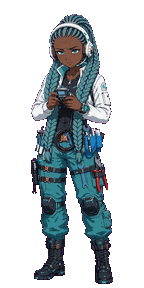
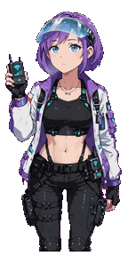
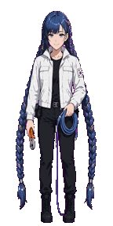
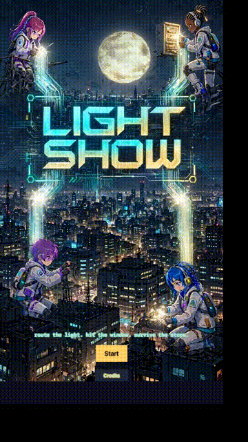
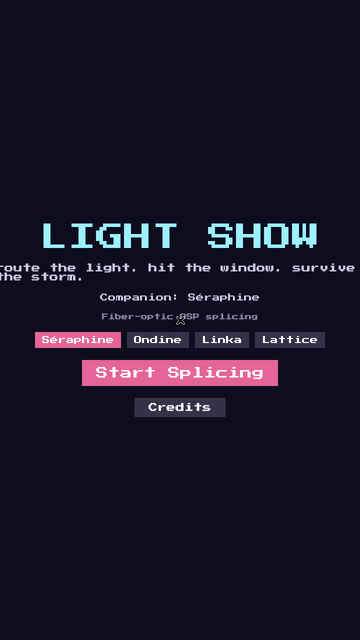

<a href="./LICENSE"></a>


<h1 align="center">Light Show</h1>

<p align="center"><em>Real OSP fiber-optic engineering as a puzzle game — one companion for every access technology.</em></p>

A puzzle game about real Outside Plant (OSP) fiber-optic engineering, built
in Rust with [Bevy](https://bevyengine.org/), for Android (Google Play +
F-Droid), with a squad of anime-styled AI companions — one per access
technology — who react to every splice you make.

## Trailer

<p align="center">
  <a href="docs/media/light-show-trailer.mp4">
    
  </a>
</p>

<p align="center"><em>Click the preview to watch the full trailer.</em></p>

## Quick start

Grab a trial build for your platform — no toolchain needed:

| Platform | Get it | Notes |
| --- | --- | --- |
| **Windows 11** | [Download from Releases](https://github.com/qompassai/light-show/releases) | Zip with the `.exe` — extract it, keep the `assets` folder next to the exe, and double-click. |
| **Linux** | [Download from Releases](https://github.com/qompassai/light-show/releases) | Tarball — extract it and run `./light-show` from the extracted folder. |
| **Android** | [Download from Releases](https://github.com/qompassai/light-show/releases) | APK — sideload it (your phone may ask you to allow installs from your browser or files app). |

These are **unsigned trial builds** for testing, ahead of the signed store
releases. On Windows, SmartScreen will flag the unsigned exe on first
launch: click **More info → Run anyway**.

<details>
<summary>Dev quick start — build from source</summary>

```sh
cargo run -p light-show
```

See [`docs/BUILD.md`](docs/BUILD.md) for Android build instructions
(Google Play `.aab` and F-Droid-reproducible `cargo-apk` paths) and
[`docs/GAME_DESIGN.md`](docs/GAME_DESIGN.md) for the full design doc,
including the link-budget model and level progression.

</details>

<details>
<summary>Meet the companions</summary>

Pick a companion from the menu before you start splicing — each one is tied
to a real access technology, has her own dialogue bank, and reacts to your
splices, outages, and level results in her own voice.

| | | | |
|---|---|---|---|
| <br>**Séraphine** — Fiber<br>*mature* | <br>**Ondine** — Coax<br>*mature* | <br>**Linka** — Wireless<br>*mature* | <br>**Lattice** — Wired<br>*mature* |

Full character briefs, palettes, and mood-sheet specs live in
[`docs/ART_STYLE.md`](docs/ART_STYLE.md).

> **Curious how the girls looked on day one?** See [`docs/progress/`](docs/progress/) —
> a lovingly embarrassing archive of the original base sprites, with commentary.

</details>

<details>
<summary>Gameplay</summary>

Real captures from the desktop build (scripted input driving the actual
game under Xvfb — no mockups). MP4 versions alongside each GIF.



**World 2 – Unity Gain.** The coax cascade is pre-wired except the line
amplifier: pick the gain that lands the carrier inside the [0, 15] dBmV
window. The ledger at the bottom recomputes the live link budget on
every change. This capture runs the full loop — the first pick (20 dB)
runs hot at Rx: 20.05 dBmV, OUT OF WINDOW; swapping in the 5 dB amp
lands Rx: 5.05 dBmV — SERVICE RESTORED. Captured with the mature
288×576 companion set (see `docs/ART_STYLE.md`); the previous base-set
captures are kept alongside as `*_base.gif`/`*_base.mp4`, and the title
screen as `title-screen.png` / `title-screen_base.png`.



**World 4 – Storm Season.** The aerial route goes up first; 20 seconds
in, the scripted storm outage cuts it and the repair banner starts its
countdown. Dragging from the protection-route splice to the ONT brings
the backup path live — SERVICE RESTORED at Loss: 2.22 dB |
Rx: −10.22 dBm | Margin: 2.22 dB | IN WINDOW.

One honest caveat: the outage clip was captured with a temporary build
that starts at level 2 — level select doesn't exist yet, and level 2 is
only reachable through the results screen.

**Every level, animated.** All 83 levels have a preview below,
captured the same way as the two features above — the game's own
`--footage` harness driving scripted input through the real game
under Xvfb, silent. Plain files are the current build's default
companion set; `*_base` files are the standard-set captures
(byte-identical to the plain capture where only one set exists
for that companion — the same convention as the outage pair).
Levels whose mechanic the harness cannot perform (console and
triage flows) run their full scripted budget as a showcase,
and outage levels whose repair runs through the interactive
alarm flow end on the outage itself — the storm is the show.

*Fiber — Séraphine*

| Level | Preview | Base set |
|---|---|---|
| World 1 — Clean Hands (`f1l3`) | [GIF](docs/gameplay/light-show-f1l3.gif) · [MP4](docs/gameplay/light-show-f1l3.mp4) | [GIF](docs/gameplay/light-show-f1l3_base.gif) · [MP4](docs/gameplay/light-show-f1l3_base.mp4) |
| World 1 — Fusion or Bust (`f1l4`) | [GIF](docs/gameplay/light-show-f1l4.gif) · [MP4](docs/gameplay/light-show-f1l4.mp4) | [GIF](docs/gameplay/light-show-f1l4_base.gif) · [MP4](docs/gameplay/light-show-f1l4_base.mp4) |
| World 1 — The Short Cut (`f1l5`) | [GIF](docs/gameplay/light-show-f1l5.gif) · [MP4](docs/gameplay/light-show-f1l5.mp4) | [GIF](docs/gameplay/light-show-f1l5_base.gif) · [MP4](docs/gameplay/light-show-f1l5_base.mp4) |
| World 1 — Split Decision (`f1l6`) | [GIF](docs/gameplay/light-show-f1l6.gif) · [MP4](docs/gameplay/light-show-f1l6.mp4) | [GIF](docs/gameplay/light-show-f1l6_base.gif) · [MP4](docs/gameplay/light-show-f1l6_base.mp4) |
| World 1 — Bend Don't Break (`f1l7`) | [GIF](docs/gameplay/light-show-f1l7.gif) · [MP4](docs/gameplay/light-show-f1l7.mp4) | [GIF](docs/gameplay/light-show-f1l7_base.gif) · [MP4](docs/gameplay/light-show-f1l7_base.mp4) |
| World 1 — Contamination Event (`f1l8`) | [GIF](docs/gameplay/light-show-f1l8.gif) · [MP4](docs/gameplay/light-show-f1l8.mp4) | [GIF](docs/gameplay/light-show-f1l8_base.gif) · [MP4](docs/gameplay/light-show-f1l8_base.mp4) |
| World 5 — Tight Budget (`f1l9`) | [GIF](docs/gameplay/light-show-f1l9.gif) · [MP4](docs/gameplay/light-show-f1l9.mp4) | [GIF](docs/gameplay/light-show-f1l9_base.gif) · [MP4](docs/gameplay/light-show-f1l9_base.mp4) |
| World 5 — Build It Right (`f1l10`) | [GIF](docs/gameplay/light-show-f1l10.gif) · [MP4](docs/gameplay/light-show-f1l10.mp4) | [GIF](docs/gameplay/light-show-f1l10_base.gif) · [MP4](docs/gameplay/light-show-f1l10_base.mp4) |

*Coax — Ondine*

| Level | Preview | Base set |
|---|---|---|
| World 2 — Unity Gain (`c1l1`) | [GIF](docs/gameplay/light-show-c1l1.gif) · [MP4](docs/gameplay/light-show-c1l1.mp4) | [GIF](docs/gameplay/light-show-c1l1_base.gif) · [MP4](docs/gameplay/light-show-c1l1_base.mp4) |
| World 2 — Ingress at Night (`c1l2`) | [GIF](docs/gameplay/light-show-c1l2.gif) · [MP4](docs/gameplay/light-show-c1l2.mp4) | [GIF](docs/gameplay/light-show-c1l2_base.gif) · [MP4](docs/gameplay/light-show-c1l2_base.mp4) |
| World 2 — Longer Run (`c1l3`) | [GIF](docs/gameplay/light-show-c1l3.gif) · [MP4](docs/gameplay/light-show-c1l3.mp4) | [GIF](docs/gameplay/light-show-c1l3_base.gif) · [MP4](docs/gameplay/light-show-c1l3_base.mp4) |
| World 2 — Tap Dance (`c1l4`) | [GIF](docs/gameplay/light-show-c1l4.gif) · [MP4](docs/gameplay/light-show-c1l4.mp4) | [GIF](docs/gameplay/light-show-c1l4_base.gif) · [MP4](docs/gameplay/light-show-c1l4_base.mp4) |
| World 2 — Ingress Returns (`c1l5`) | [GIF](docs/gameplay/light-show-c1l5.gif) · [MP4](docs/gameplay/light-show-c1l5.mp4) | [GIF](docs/gameplay/light-show-c1l5_base.gif) · [MP4](docs/gameplay/light-show-c1l5_base.mp4) |
| World 2 — Backup Plan (`c1l6`) | [GIF](docs/gameplay/light-show-c1l6.gif) · [MP4](docs/gameplay/light-show-c1l6.mp4) | [GIF](docs/gameplay/light-show-c1l6_base.gif) · [MP4](docs/gameplay/light-show-c1l6_base.mp4) |
| World 2 — Hot Headend (`c1l7`) | [GIF](docs/gameplay/light-show-c1l7.gif) · [MP4](docs/gameplay/light-show-c1l7.mp4) | [GIF](docs/gameplay/light-show-c1l7_base.gif) · [MP4](docs/gameplay/light-show-c1l7_base.mp4) |
| World 2 — The Long Cascade (`c1l8`) | [GIF](docs/gameplay/light-show-c1l8.gif) · [MP4](docs/gameplay/light-show-c1l8.mp4) | [GIF](docs/gameplay/light-show-c1l8_base.gif) · [MP4](docs/gameplay/light-show-c1l8_base.mp4) |
| World 6 — Precision Run (`c1l9`) | [GIF](docs/gameplay/light-show-c1l9.gif) · [MP4](docs/gameplay/light-show-c1l9.mp4) | [GIF](docs/gameplay/light-show-c1l9_base.gif) · [MP4](docs/gameplay/light-show-c1l9_base.mp4) |
| World 6 — Ingress Storm (`c1l10`) | [GIF](docs/gameplay/light-show-c1l10.gif) · [MP4](docs/gameplay/light-show-c1l10.mp4) | [GIF](docs/gameplay/light-show-c1l10_base.gif) · [MP4](docs/gameplay/light-show-c1l10_base.mp4) |

*Ethernet — Lattice*

| Level | Preview | Base set |
|---|---|---|
| World 4 — The Hundred-Meter Wall (`e1l1`) | [GIF](docs/gameplay/light-show-e1l1.gif) · [MP4](docs/gameplay/light-show-e1l1.mp4) | [GIF](docs/gameplay/light-show-e1l1_base.gif) · [MP4](docs/gameplay/light-show-e1l1_base.mp4) |
| World 4 — Power Budget (`e1l2`) | [GIF](docs/gameplay/light-show-e1l2.gif) · [MP4](docs/gameplay/light-show-e1l2.mp4) | [GIF](docs/gameplay/light-show-e1l2_base.gif) · [MP4](docs/gameplay/light-show-e1l2_base.mp4) |
| World 4 — Category Matters (`e1l3`) | [GIF](docs/gameplay/light-show-e1l3.gif) · [MP4](docs/gameplay/light-show-e1l3.mp4) | [GIF](docs/gameplay/light-show-e1l3_base.gif) · [MP4](docs/gameplay/light-show-e1l3_base.mp4) |
| World 4 — The Long Corridor (`e1l4`) | [GIF](docs/gameplay/light-show-e1l4.gif) · [MP4](docs/gameplay/light-show-e1l4.mp4) | [GIF](docs/gameplay/light-show-e1l4_base.gif) · [MP4](docs/gameplay/light-show-e1l4_base.mp4) |
| World 4 — Power Hungry (`e1l5`) | [GIF](docs/gameplay/light-show-e1l5.gif) · [MP4](docs/gameplay/light-show-e1l5.mp4) | [GIF](docs/gameplay/light-show-e1l5_base.gif) · [MP4](docs/gameplay/light-show-e1l5_base.mp4) |
| World 4 — Every Constraint (`e1l6`) | [GIF](docs/gameplay/light-show-e1l6.gif) · [MP4](docs/gameplay/light-show-e1l6.mp4) | [GIF](docs/gameplay/light-show-e1l6_base.gif) · [MP4](docs/gameplay/light-show-e1l6_base.mp4) |
| World 5 — The Campus (`e1l7`) | [GIF](docs/gameplay/light-show-e1l7.gif) · [MP4](docs/gameplay/light-show-e1l7.mp4) | [GIF](docs/gameplay/light-show-e1l7_base.gif) · [MP4](docs/gameplay/light-show-e1l7_base.mp4) |
| World 5 — No Slack (`e1l8`) | [GIF](docs/gameplay/light-show-e1l8.gif) · [MP4](docs/gameplay/light-show-e1l8.mp4) | [GIF](docs/gameplay/light-show-e1l8_base.gif) · [MP4](docs/gameplay/light-show-e1l8_base.mp4) |
| World 5 — Retrofit (`e1l9`) | [GIF](docs/gameplay/light-show-e1l9.gif) · [MP4](docs/gameplay/light-show-e1l9.mp4) | [GIF](docs/gameplay/light-show-e1l9_base.gif) · [MP4](docs/gameplay/light-show-e1l9_base.mp4) |
| World 5 — The Data Center (`e1l10`) | [GIF](docs/gameplay/light-show-e1l10.gif) · [MP4](docs/gameplay/light-show-e1l10.mp4) | [GIF](docs/gameplay/light-show-e1l10_base.gif) · [MP4](docs/gameplay/light-show-e1l10_base.mp4) |

*Wireless — Linka*

| Level | Preview | Base set |
|---|---|---|
| World 3 — Close the Link (`m1l1`) | [GIF](docs/gameplay/light-show-m1l1.gif) · [MP4](docs/gameplay/light-show-m1l1.mp4) | [GIF](docs/gameplay/light-show-m1l1_base.gif) · [MP4](docs/gameplay/light-show-m1l1_base.mp4) |
| World 3 — Ride the Storm (`m1l2`) | [GIF](docs/gameplay/light-show-m1l2.gif) · [MP4](docs/gameplay/light-show-m1l2.mp4) | [GIF](docs/gameplay/light-show-m1l2_base.gif) · [MP4](docs/gameplay/light-show-m1l2_base.mp4) |
| World 3 — Thread the Needle (`m1l3`) | [GIF](docs/gameplay/light-show-m1l3.gif) · [MP4](docs/gameplay/light-show-m1l3.mp4) | [GIF](docs/gameplay/light-show-m1l3_base.gif) · [MP4](docs/gameplay/light-show-m1l3_base.mp4) |
| World 3 — The 5GHz Tax (`m1l4`) | [GIF](docs/gameplay/light-show-m1l4.gif) · [MP4](docs/gameplay/light-show-m1l4.mp4) | [GIF](docs/gameplay/light-show-m1l4_base.gif) · [MP4](docs/gameplay/light-show-m1l4_base.mp4) |
| World 3 — After the Repeater (`m1l5`) | [GIF](docs/gameplay/light-show-m1l5.gif) · [MP4](docs/gameplay/light-show-m1l5.mp4) | [GIF](docs/gameplay/light-show-m1l5_base.gif) · [MP4](docs/gameplay/light-show-m1l5_base.mp4) |
| World 3 — Loud Is Not Clear (`m1l6`) | [GIF](docs/gameplay/light-show-m1l6.gif) · [MP4](docs/gameplay/light-show-m1l6.mp4) | [GIF](docs/gameplay/light-show-m1l6_base.gif) · [MP4](docs/gameplay/light-show-m1l6_base.mp4) |
| World 4 — The Long Haul (`m1l7`) | [GIF](docs/gameplay/light-show-m1l7.gif) · [MP4](docs/gameplay/light-show-m1l7.mp4) | [GIF](docs/gameplay/light-show-m1l7_base.gif) · [MP4](docs/gameplay/light-show-m1l7_base.mp4) |
| World 4 — Aim High (`m1l8`) | [GIF](docs/gameplay/light-show-m1l8.gif) · [MP4](docs/gameplay/light-show-m1l8.mp4) | [GIF](docs/gameplay/light-show-m1l8_base.gif) · [MP4](docs/gameplay/light-show-m1l8_base.mp4) |
| World 4 — Mixed Bands (`m1l9`) | [GIF](docs/gameplay/light-show-m1l9.gif) · [MP4](docs/gameplay/light-show-m1l9.mp4) | [GIF](docs/gameplay/light-show-m1l9_base.gif) · [MP4](docs/gameplay/light-show-m1l9_base.mp4) |
| World 5 — Linka's Gauntlet (`m1l10`) | [GIF](docs/gameplay/light-show-m1l10.gif) · [MP4](docs/gameplay/light-show-m1l10.mp4) | [GIF](docs/gameplay/light-show-m1l10_base.gif) · [MP4](docs/gameplay/light-show-m1l10_base.mp4) |

*Clara*

| Level | Preview | Base set |
|---|---|---|
| World 5 — First Turn-Up (`clara1`) | — | [GIF](docs/gameplay/light-show-clara1_base.gif) · [MP4](docs/gameplay/light-show-clara1_base.mp4) |
| World 5 — Storm Season (`clara2`) | — | [GIF](docs/gameplay/light-show-clara2_base.gif) · [MP4](docs/gameplay/light-show-clara2_base.mp4) |
| World 5 — Dead Box Swap (`clara3`) | — | [GIF](docs/gameplay/light-show-clara3_base.gif) · [MP4](docs/gameplay/light-show-clara3_base.mp4) |
| World 5 — Profile Audit (`clara4`) | — | [GIF](docs/gameplay/light-show-clara4_base.gif) · [MP4](docs/gameplay/light-show-clara4_base.mp4) |
| World 5 — Drive the NBI (`clara5`) | — | [GIF](docs/gameplay/light-show-clara5_base.gif) · [MP4](docs/gameplay/light-show-clara5_base.mp4) |
| World 5 — Bulk Turn-Up (`clara6`) | — | [GIF](docs/gameplay/light-show-clara6_base.gif) · [MP4](docs/gameplay/light-show-clara6_base.mp4) |
| World 5 — SMx Lifecycle (`clara7`) | — | [GIF](docs/gameplay/light-show-clara7_base.gif) · [MP4](docs/gameplay/light-show-clara7_base.mp4) |
| World 5 — Building Turn-Up (`clara8`) | — | [GIF](docs/gameplay/light-show-clara8_base.gif) · [MP4](docs/gameplay/light-show-clara8_base.mp4) |
| World 5 — Tight Budget (`clara9`) | — | [GIF](docs/gameplay/light-show-clara9_base.gif) · [MP4](docs/gameplay/light-show-clara9_base.mp4) |
| World 5 — Night Cutover (`clara10`) | — | [GIF](docs/gameplay/light-show-clara10_base.gif) · [MP4](docs/gameplay/light-show-clara10_base.mp4) |

*Aino*

| Level | Preview | Base set |
|---|---|---|
| World 6 — First Shift (`aino1`) | — | [GIF](docs/gameplay/light-show-aino1_base.gif) · [MP4](docs/gameplay/light-show-aino1_base.mp4) |
| World 6 — Triage Order (`aino2`) | — | [GIF](docs/gameplay/light-show-aino2_base.gif) · [MP4](docs/gameplay/light-show-aino2_base.mp4) |
| World 6 — The Cascade (`aino3`) | — | [GIF](docs/gameplay/light-show-aino3_base.gif) · [MP4](docs/gameplay/light-show-aino3_base.mp4) |
| World 6 — Bulk Ack (`aino4`) | — | [GIF](docs/gameplay/light-show-aino4_base.gif) · [MP4](docs/gameplay/light-show-aino4_base.mp4) |
| World 6 — Query the NBI (`aino5`) | — | [GIF](docs/gameplay/light-show-aino5_base.gif) · [MP4](docs/gameplay/light-show-aino5_base.mp4) |
| World 6 — Supervision (`aino6`) | — | [GIF](docs/gameplay/light-show-aino6_base.gif) · [MP4](docs/gameplay/light-show-aino6_base.mp4) |
| World 6 — Night Shift (`aino7`) | — | [GIF](docs/gameplay/light-show-aino7_base.gif) · [MP4](docs/gameplay/light-show-aino7_base.mp4) |
| World 6 — Maintenance Window (`aino8`) | — | [GIF](docs/gameplay/light-show-aino8_base.gif) · [MP4](docs/gameplay/light-show-aino8_base.mp4) |
| World 6 — SOAP Fault (`aino9`) | — | [GIF](docs/gameplay/light-show-aino9_base.gif) · [MP4](docs/gameplay/light-show-aino9_base.mp4) |
| World 6 — All Clear (`aino10`) | — | [GIF](docs/gameplay/light-show-aino10_base.gif) · [MP4](docs/gameplay/light-show-aino10_base.mp4) |

*Hikari*

| Level | Preview | Base set |
|---|---|---|
| World 7 — First Day on the Route (`hikari1`) | — | [GIF](docs/gameplay/light-show-hikari1_base.gif) · [MP4](docs/gameplay/light-show-hikari1_base.mp4) |
| World 7 — Address to Diagnostics (`hikari2`) | — | [GIF](docs/gameplay/light-show-hikari2_base.gif) · [MP4](docs/gameplay/light-show-hikari2_base.mp4) |
| World 7 — Beat the Callback (`hikari3`) | — | [GIF](docs/gameplay/light-show-hikari3_base.gif) · [MP4](docs/gameplay/light-show-hikari3_base.mp4) |
| World 7 — The Dirty Drop (`hikari4`) | — | [GIF](docs/gameplay/light-show-hikari4_base.gif) · [MP4](docs/gameplay/light-show-hikari4_base.mp4) |
| World 7 — Certify It (`hikari5`) | — | [GIF](docs/gameplay/light-show-hikari5_base.gif) · [MP4](docs/gameplay/light-show-hikari5_base.mp4) |
| World 7 — Slow Portal (`hikari6`) | — | [GIF](docs/gameplay/light-show-hikari6_base.gif) · [MP4](docs/gameplay/light-show-hikari6_base.mp4) |
| World 7 — Bend in the Wall (`hikari7`) | — | [GIF](docs/gameplay/light-show-hikari7_base.gif) · [MP4](docs/gameplay/light-show-hikari7_base.mp4) |
| World 7 — The Splitter Closet (`hikari8`) | — | [GIF](docs/gameplay/light-show-hikari8_base.gif) · [MP4](docs/gameplay/light-show-hikari8_base.mp4) |
| World 7 — Night Trouble Call (`hikari9`) | — | [GIF](docs/gameplay/light-show-hikari9_base.gif) · [MP4](docs/gameplay/light-show-hikari9_base.mp4) |
| World 7 — Master Tech (`hikari10`) | — | [GIF](docs/gameplay/light-show-hikari10_base.gif) · [MP4](docs/gameplay/light-show-hikari10_base.mp4) |

*Lea — study & quiz*

| Level | Preview | Base set |
|---|---|---|
| World 8 — Study Hall Warm-Up (`lea1`) | — | [GIF](docs/gameplay/light-show-lea1_base.gif) · [MP4](docs/gameplay/light-show-lea1_base.mp4) |
| World 8 — Grounded: Article 250 (`lea2`) | — | [GIF](docs/gameplay/light-show-lea2_base.gif) · [MP4](docs/gameplay/light-show-lea2_base.mp4) |
| World 8 — Wiring Methods: Articles 300-398 (`lea3`) | — | [GIF](docs/gameplay/light-show-lea3_base.gif) · [MP4](docs/gameplay/light-show-lea3_base.mp4) |
| World 8 — Hazardous Locations: Articles 500-516 (`lea4`) | — | [GIF](docs/gameplay/light-show-lea4_base.gif) · [MP4](docs/gameplay/light-show-lea4_base.mp4) |
| World 8 — Special Conditions: Articles 705-780 (`lea5`) | — | [GIF](docs/gameplay/light-show-lea5_base.gif) · [MP4](docs/gameplay/light-show-lea5_base.mp4) |
| World 8 — Comms Systems Boss: Articles 800-830 (`lea6`) | — | [GIF](docs/gameplay/light-show-lea6_base.gif) · [MP4](docs/gameplay/light-show-lea6_base.mp4) |
| World 8 — Theory Workshop (`lea7`) | — | [GIF](docs/gameplay/light-show-lea7_base.gif) · [MP4](docs/gameplay/light-show-lea7_base.mp4) |
| World 8 — Washington Law: RCW 19.28 (`lea8`) | — | [GIF](docs/gameplay/light-show-lea8_base.gif) · [MP4](docs/gameplay/light-show-lea8_base.mp4) |
| World 8 — Washington Admin Code: WAC 296-46B (`lea9`) | — | [GIF](docs/gameplay/light-show-lea9_base.gif) · [MP4](docs/gameplay/light-show-lea9_base.mp4) |
| World 8 — Mock Exam: Final Boss (`lea10`) | — | [GIF](docs/gameplay/light-show-lea10_base.gif) · [MP4](docs/gameplay/light-show-lea10_base.mp4) |

*Field jobs & splice tray*

| Level | Preview | Base set |
|---|---|---|
| World 1 — The Brewhouse Job — Replace the 1x4 (`fj1`) | [GIF](docs/gameplay/light-show-fj1.gif) · [MP4](docs/gameplay/light-show-fj1.mp4) | [GIF](docs/gameplay/light-show-fj1_base.gif) · [MP4](docs/gameplay/light-show-fj1_base.mp4) |
| World 1 — The Brewhouse Job — Prove the SB (`fj2`) | [GIF](docs/gameplay/light-show-fj2.gif) · [MP4](docs/gameplay/light-show-fj2.mp4) | [GIF](docs/gameplay/light-show-fj2_base.gif) · [MP4](docs/gameplay/light-show-fj2_base.mp4) |
| World 1 — True to the Color (`sp1`) | [GIF](docs/gameplay/light-show-sp1.gif) · [MP4](docs/gameplay/light-show-sp1.mp4) | [GIF](docs/gameplay/light-show-sp1_base.gif) · [MP4](docs/gameplay/light-show-sp1_base.mp4) |

*Worlds*

| Level | Preview | Base set |
|---|---|---|
| World 1 — First Light (`w1l1`) | [GIF](docs/gameplay/light-show-level1.gif) · [MP4](docs/gameplay/light-show-level1.mp4) | [GIF](docs/gameplay/light-show-level1_base.gif) · [MP4](docs/gameplay/light-show-level1_base.mp4) |
| World 4 — Storm Season (`w4l1`) | [GIF](docs/gameplay/light-show-outage.gif) · [MP4](docs/gameplay/light-show-outage.mp4) | [GIF](docs/gameplay/light-show-outage_base.gif) · [MP4](docs/gameplay/light-show-outage_base.mp4) |

</details>

<details>
<summary>Project layout</summary>

```
crates/osp_sim/       Engine-agnostic fiber-optic link-budget simulation core
game/                  Bevy application: states, UI, level loading, companions
game/assets/levels/    Level definitions (JSON)
game/assets/dialogue/  Per-companion dialogue banks (JSON, localizable)
game/assets/sprites/   In-engine sprite sheets, incl. companion mood sheets
game/assets/audio/     Chiptune music loops + win/fail jingles (.ogg)
assets/art/<name>/    Per-companion art: source portraits, expressions, animated profile GIFs; app icon art stays in assets/art/companions/
art/aseprite/          Aseprite-ready sprite sources + headless import script
art/unreal/            Content-only Unreal preview project (Paper2D) for the same art
docs/                  Design, art direction, asset pipeline, build, and F-Droid docs
fastlane/              Shared Play Store / F-Droid store listing metadata
tools/                 Art + music generation scripts (placeholder art, companion art, chiptune)
```

</details>

<details>
<summary>Status</summary>

Feature-complete gameplay loop: core simulation (`osp_sim`) is fully
implemented and tested; the Bevy front-end has a working state machine
(menu → playing → outage-repair → results), level loading, win/fail
condition checking with a live dB ledger UI, a companion-select menu,
an outage-repair loop (fault injection, live reroute under a countdown,
in-window vs. timed-out resolution), a results screen with win/fail
banners and companion dialogue, all four companions' dialogue/animation
systems (backed by real AI-generated portrait art and 64x64 in-engine
sprite sheets with per-mood accent tinting), on-board component icon
sprites for every placeable part, and a full Megaman-esque chiptune
soundtrack (menu/playing/outage loops, win/fail jingles) wired to every
state. See [`docs/ASSET_PIPELINE.md`](docs/ASSET_PIPELINE.md) for how
all art/audio is generated and how to take it further in Aseprite or
Unreal. Remaining before store submission is entirely account/asset
logistics rather than code: a signing keystore, real device
screenshots, and the Play Console/`fdroiddata` listing steps — see
[`docs/BUILD.md`](docs/BUILD.md) and [`docs/FDROID.md`](docs/FDROID.md).

</details>

<details>
<summary>License</summary>

Apache-2.0. See [`LICENSE`](LICENSE) and
[`docs/CREDITS.md`](docs/CREDITS.md) for asset attribution.

</details>

<details>
<summary>Music</summary>

Twelve licensed tracks ship with the game, grouped below by the music-manager
tier that plays them (`game/src/audio.rs`). Click a group to expand it, then a
track title for its details and listen link.

GitHub strips `<audio>` tags from rendered markdown, so an in-README
play/pause button is not possible — the ▶ link is the mechanism: it opens
GitHub's file viewer for the track, which renders its own audio player with
play/pause and scrubbing.

<details>
<summary>Menu (1 track)</summary>

<details>
<summary>🎵 "We're all under the stars" — Eric Skiff</summary>

▶ [Listen](https://github.com/qompassai/light-show/blob/main/game/assets/music/menu/eric-skiff-16-were-all-under-the-stars.mp3)

Music: Eric Skiff - We're all under the stars - Resistor Anthems -
Available at http://EricSkiff.com/music · CC BY 4.0 · Plays on: main menu.
</details>

</details>

<details>
<summary>Tutorial, levels 0–1 (1 track)</summary>

<details>
<summary>🎵 "Intensive puzzle resolution" — Komiku</summary>

▶ [Listen](https://github.com/qompassai/light-show/blob/main/game/assets/music/tutorial/komiku-intensive-puzzle-resolution.mp3)

Komiku (Free Music Archive, https://freemusicarchive.org) · CC0 1.0
Universal · Plays on: tutorial levels.
</details>

</details>

<details>
<summary>Early, level 2 (2 tracks)</summary>

<details>
<summary>🎵 "Searching" — Eric Skiff</summary>

▶ [Listen](https://github.com/qompassai/light-show/blob/main/game/assets/music/early/eric-skiff-06-searching.mp3)

Music: Eric Skiff - Searching - Resistor Anthems - Available at
http://EricSkiff.com/music · CC BY 4.0 · Plays on: early levels.
</details>

<details>
<summary>🎵 "Ascending" — Eric Skiff</summary>

▶ [Listen](https://github.com/qompassai/light-show/blob/main/game/assets/music/early/eric-skiff-08-ascending.mp3)

Music: Eric Skiff - Ascending - Resistor Anthems - Available at
http://EricSkiff.com/music · CC BY 4.0 · Plays on: early levels.
</details>

</details>

<details>
<summary>Mid, level 3 (2 tracks)</summary>

<details>
<summary>🎵 "Chibi Ninja" — Eric Skiff</summary>

▶ [Listen](https://github.com/qompassai/light-show/blob/main/game/assets/music/mid/eric-skiff-03-chibi-ninja.mp3)

Music: Eric Skiff - Chibi Ninja - Resistor Anthems - Available at
http://EricSkiff.com/music · CC BY 4.0 · Plays on: mid levels.
</details>

<details>
<summary>🎵 "Underclocked (underunderclocked mix)" — Eric Skiff</summary>

▶ [Listen](https://github.com/qompassai/light-show/blob/main/game/assets/music/mid/eric-skiff-02-underclocked.mp3)

Music: Eric Skiff - Underclocked (underunderclocked mix) - Available at
http://EricSkiff.com/music · CC BY 4.0 · Plays on: mid levels.
</details>

</details>

<details>
<summary>Hard, level 4+ (2 tracks)</summary>

<details>
<summary>🎵 "Exhilarate" — Kevin MacLeod</summary>

▶ [Listen](https://github.com/qompassai/light-show/blob/main/game/assets/music/hard/kevin-macleod-exhilarate.mp3)

Kevin MacLeod (https://incompetech.com/music/royalty-free/) · CC BY 4.0 ·
Plays on: hard levels.
</details>

<details>
<summary>🎵 "Action2 - Army Approaching" — Juhani Junkala / SubspaceAudio</summary>

▶ [Listen](https://github.com/qompassai/light-show/blob/main/game/assets/music/hard/subspaceaudio-action2-army-approaching.ogg)

Juhani Junkala / SubspaceAudio, JRPG Pack 5: Action
(https://opengameart.org/content/jrpg-pack-5-action) · CC0 · Plays on: hard
levels.
</details>

</details>

<details>
<summary>Boss (2 tracks)</summary>

<details>
<summary>🎵 "Basic Metal 5" — TeknoAXE</summary>

▶ [Listen](https://github.com/qompassai/light-show/blob/main/game/assets/music/boss/teknoaxe-basic-metal-5.mp3)

Basic Metal 5 by TeknoAXE | http://teknoaxe.com — Royalty Free Music by
https://www.free-stock-music.com · CC BY 4.0 · Plays on: boss levels.
</details>

<details>
<summary>🎵 "Action3 - Preparing For Battle" — Juhani Junkala / SubspaceAudio</summary>

▶ [Listen](https://github.com/qompassai/light-show/blob/main/game/assets/music/boss/subspaceaudio-action3-preparing-for-battle.ogg)

Juhani Junkala / SubspaceAudio, JRPG Pack 5: Action
(https://opengameart.org/content/jrpg-pack-5-action) · CC0 · Plays on: boss
levels.
</details>

</details>

<details>
<summary>Victory (1 track)</summary>

<details>
<summary>🎵 "We're the Resistors" — Eric Skiff</summary>

▶ [Listen](https://github.com/qompassai/light-show/blob/main/game/assets/music/victory/eric-skiff-07-were-the-resistors.mp3)

Music: Eric Skiff - We're the Resistors - Resistor Anthems - Available at
http://EricSkiff.com/music · CC BY 4.0 · Plays on: victory screen.
</details>

</details>

<details>
<summary>Mystery (1 track)</summary>

<details>
<summary>🎵 "In a Heartbeat" — Kevin MacLeod</summary>

▶ [Listen](https://github.com/qompassai/light-show/blob/main/game/assets/music/mystery/kevin-macleod-in-a-heartbeat.mp3)

Kevin MacLeod (https://incompetech.com/music/royalty-free/) · CC BY 3.0 ·
Plays on: mystery events.
</details>

</details>

Full attribution lives in [`game/assets/music/ATTRIBUTION.txt`](https://github.com/qompassai/light-show/blob/main/game/assets/music/ATTRIBUTION.txt)
(also shown in-game on the credits screen) and
[`game/assets/music/CREDITS.md`](https://github.com/qompassai/light-show/blob/main/game/assets/music/CREDITS.md).

</details>

<details>
<summary>Store compliance</summary>

No ads, no in-app purchases, no tracking, no network permission requested —
the same build ships unmodified to both Google Play and F-Droid. See
[`docs/FDROID.md`](docs/FDROID.md) for the anti-features checklist.

</details>

## License

This project is licensed under the [Apache License, Version 2.0](./LICENSE).
